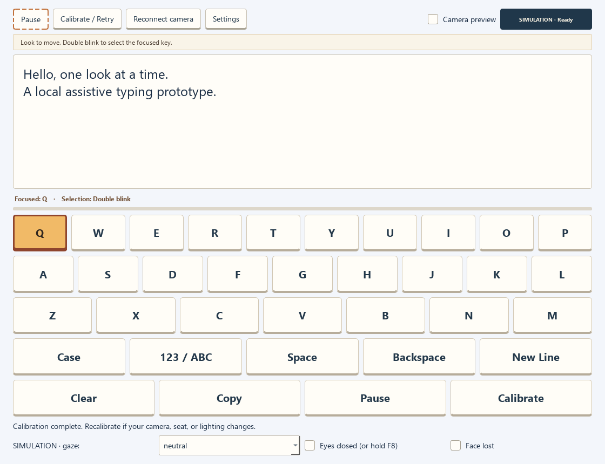
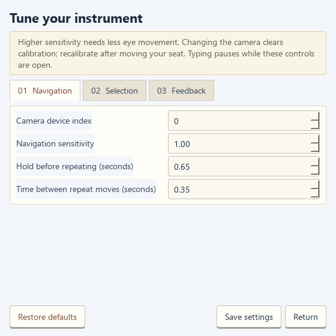

# Gaze-Controlled Virtual Keyboard

Type using directional eye movements and deliberate blinks with a regular webcam. This Python desktop application uses MediaPipe Face Landmarker, OpenCV and PySide6 to move a highlighted key around an on-screen keyboard. A double blink selects the key by default; single-blink and dwell selection are also available.

Designed as an assistive typing prototype, with a warm yellow keyboard, a compact control bar, an optional camera preview and adjustable settings. It uses directional gaze commands rather than estimating the exact screen location you are looking at.



*The screenshot shows the current interface using simulated input, without a camera.*

## Features

- Calibrated left, right, up and down eye navigation; return to neutral to stop moving.
- Double blink, single blink or dwell selection, with configurable timing and sensitivity.
- QWERTY letters, uppercase/lowercase, numbers and punctuation.
- Space, Backspace, New Line, Copy and Clear with confirmation.
- Eye-accessible Pause, Resume and Calibrate keys.
- Large typing area and amber focus highlighting; green confirms selection.
- Optional mirrored camera preview with eye/iris landmarks.
- Navigation, Selection and Feedback settings tabs.
- Local selection sounds, optional navigation tones and prerecorded speech for supported keys.
- Simulation mode for trying the interface without a webcam.
- Local settings and calibration profiles; typed text is not automatically saved.

## Requirements

The supported setup described here is **Windows with Python 3.12, 64-bit**. You need a webcam for eye control, reasonable lighting and an unobstructed view of both eyes. Git is needed only for the clone instructions; alternatively download and extract the repository ZIP. Other operating systems have not been verified.

Install Python 3.12 and Git first. Internet is needed to install packages and download the face landmark model. The application code processes camera frames locally and does not upload them or record video. Normal use does not require an online speech service.

## Install and launch

Open **PowerShell** in the folder where you want to keep the project. Run these commands one at a time:

```powershell
git clone https://github.com/ADworld05/gaze-controlled-virtual-keyboard.git
cd gaze-controlled-virtual-keyboard
py -3.12 -m venv .venv
.\.venv\Scripts\python.exe -m pip install --upgrade pip
.\.venv\Scripts\python.exe -m pip install -r requirements.txt
.\.venv\Scripts\python.exe tools\setup_assets.py
.\.venv\Scripts\python.exe -m app
```

The setup script downloads `assets/models/face_landmarker.task`, records its checksum and generates the selection/navigation tones if missing. The model is intentionally excluded from Git; always run the setup command after a new clone. Run commands from the repository root, which contains `README.md` and `requirements.txt`. Do not run `app/ui.py` directly.

After setup, launch again with:

```powershell
cd path\to\gaze-controlled-virtual-keyboard
.\.venv\Scripts\python.exe -m app
```

No environment activation is required for these commands. `requirements.txt` pins the four direct application packages; pip installs their dependencies. `requirements-lock.txt` records the fuller package set from the development environment and is available for reproducing that environment instead of the shorter requirements file. A fresh install on every platform has not been verified.

### Using Miniconda instead

Use an **Anaconda/Miniconda Prompt** and run the following from the cloned repository folder. Choose either this environment or the `.venv` method above.

```powershell
conda create -n gaze-keyboard python=3.12 -y
conda activate gaze-keyboard
python -m pip install -r requirements.txt
python tools\setup_assets.py
python -m app
```

On later runs, activate `gaze-keyboard`, enter the repository folder and run `python -m app`.

## First-time use

1. Launch the app. Enable **Camera preview** if you want to see the camera feed and eye landmarks.
2. Keep your head still, face the camera and use steady lighting. If the wrong camera opens, choose its device index in **Settings → Navigation**, save, and use **Reconnect camera**.
3. Click **Calibrate / Retry**. Follow Neutral, Left, Right, Up, Down and Blink. Each direction has a settling countdown followed by sampling. During the blink step, make several short deliberate blinks and reopen your eyes between them.
4. Once calibration succeeds, look left/right/up/down to move the amber highlight. Look straight ahead to stop. Holding a direction repeats movement after a delay.
5. With the desired key highlighted, make two short deliberate blinks, reopening between them. The selected key briefly turns green and its character appears in the text area.
6. Use **Copy** to copy the text into another program. **Clear** asks for confirmation. Recalibrate after changing your camera position, seating or lighting.

Looking directly at a letter does not automatically target it: eye direction moves the highlight one step at a time. Mouse and physical keyboard controls are available for setup or assistance.

### Selection modes and gestures

| Mode/action | How to use it |
| --- | --- |
| Double blink (default) | Two complete brief blinks with an open-eye gap select the focused key. |
| Single blink | One deliberate brief blink selects the focused key. Enable it in Settings. |
| Dwell | Keep the same key focused with eyes open until the progress bar fills. Leave and return before selecting that key again. |
| Pause / Resume | Select Pause on the keyboard. The board changes to Resume and Calibrate. Select Resume to return. |
| Dwell resume | Look to Calibrate, then back to Resume and dwell. A steady gaze cannot immediately undo a pause. |

Long eye closure, winks and head gestures are not selection commands. Losing tracking clears pending gestures. Natural blinks can still cause accidental selections, especially in single-blink mode; adjust the timing and sensitivity to suit the user.

### Keyboard shortcuts

| Shortcut | Action |
| --- | --- |
| Ctrl + Arrow keys | Move the focused key |
| Ctrl + Enter | Select the focused key |
| Ctrl + P | Pause / Resume |
| Ctrl + R | Start calibration |

You can also click on-screen keys and type normally in the text area. Text entry stays inside this application; Copy transfers it to the clipboard.

## Settings

- **Navigation:** camera index, gaze sensitivity, initial repeat delay and repeat interval. Higher sensitivity requires less eye movement.
- **Selection:** double/single blink or dwell; blink sensitivity and duration limits, double-blink gap, selection cooldown and dwell duration.
- **Feedback:** sound volume, sound enable/disable, navigation tone, optional prerecorded key speech and camera preview visibility.

**Restore defaults** fills in default values; **Save settings** applies them. **Return** closes without applying edits. Eye typing is suspended while Settings is open. On Windows, configuration is stored in `%LOCALAPPDATA%\GazeKeyboardV2` as `settings.json` and `calibration.json`. These personal files are outside the repository. Camera changes clear calibration. Text is not restored after closing, so copy anything you want to keep.



## Try it without a webcam

```powershell
.\.venv\Scripts\python.exe -m app --simulate
```

Use the simulation gaze dropdown to move the highlight, then choose neutral to stop. Hold F8 for roughly 0.15–0.3 seconds and release to simulate a blink; repeat with a short gap for double blink. The Eyes closed and Face lost checkboxes simulate closure and loss of tracking. Simulation uses a synthetic calibration profile and does not replace your real calibration.

## Repository contents

| Path | Purpose |
| --- | --- |
| `app/__main__.py` | Entry point: run with `python -m app`. |
| `app/ui.py` | Main window, keyboard rendering and application coordination. |
| `app/settings_ui.py` | Tabbed Settings dialog. |
| `app/settings.py` | Validated configuration and local storage. |
| `app/camera.py` | Background camera capture and MediaPipe inference. |
| `app/tracking.py` | Eye and iris geometry from face landmarks. |
| `app/calibration.py` | Guided calibration data and directional transformation. |
| `app/control.py` | Navigation, blink and dwell timing/state logic. |
| `app/keyboard.py` | Letter/symbol layouts and focused-key movement. |
| `app/sound.py` | Local sounds and optional prerecorded speech. |
| `assets/sounds/` | Selection/navigation tones and optional voice clips. |
| `assets/models/` | Model downloaded during setup; not included in Git. |
| `tools/setup_assets.py` | One-time model and tone setup. |
| `tools/verify_*.py` | UI, model and simulated camera checks. |
| `tests/test_control.py` | Automated geometry, calibration and control tests. |
| `docs/` | Screenshots, model provenance, review notes and manual checks. |
| `requirements.txt` | Pinned direct runtime dependencies. |
| `requirements-lock.txt` | Full dependency snapshot from the development environment. |
| `.gitignore` | Keeps environments, generated models and old UI backups out of Git. |

The source in `app/` is the current yellow-tinted version. The local `ui_redesign/` folder holds an earlier interface backup and is excluded from uploads.

## Checks for contributors

From the repository root, after installing the dependencies:

```powershell
.\.venv\Scripts\python.exe -m unittest discover -s tests -v
.\.venv\Scripts\python.exe -m pip check
.\.venv\Scripts\python.exe tools\verify_ui.py
.\.venv\Scripts\python.exe tools\verify_model.py
.\.venv\Scripts\python.exe tools\verify_camera.py
```

The UI check uses offscreen simulation and updates documentation screenshots. The camera check uses a simulated capture source; it does not establish real webcam accuracy. Model and camera checks require the downloaded model. See [manual webcam checklist](docs/manual_checklist.md), [model and asset provenance](docs/model.md), [source review](docs/source_review.md) and [historical verification notes](docs/verification.md).

## Troubleshooting

| Problem | What to try |
| --- | --- |
| Python 3.12 is not found | Install 64-bit Python 3.12, or use the Miniconda instructions. |
| Missing model / camera unavailable | Run `tools/setup_assets.py`, check camera permission in Windows Settings and close other apps using the webcam. |
| Wrong camera | Change the camera index in Settings, save and reconnect. |
| Face not found / unreliable movement | Improve lighting, keep both eyes visible, steady your head and recalibrate. |
| Accidental selection | Use double blink, adjust blink sensitivity/timing and increase selection cooldown. |
| Focus moves too quickly | Reduce sensitivity or increase repeat delays. |
| No sound / speech for a key | Check Feedback settings and audio output. Speech is limited to the available local clips. |
| OpenCV package conflict | Create a fresh environment and install this requirements file; use only `opencv-contrib-python`. |

## Scope and limitations

This is a webcam-based assistive typing prototype, not a clinically validated accessibility device. Lighting, glasses, eye visibility, head movement, camera quality and individual movement range affect results. Typing speed and live accuracy have not been formally measured. Setup may require assistance. Camera driver stalls can delay shutdown while the app waits for capture to finish.

There is no word prediction, online text generation, global keystroke injection, wink command or long-blink command. Application code does not save camera frames or typed text. Third-party packages retain their own behavior and terms; the observed offline behavior of the pinned MediaPipe release is discussed in the model notes.

## Assets and licensing

The face landmark model comes from Google MediaPipe; see [model and asset provenance](docs/model.md). Optional voice clips were inherited from the original project; that document records the known source information. No new license or redistribution permission is asserted for third-party assets. The original project code is licensed under the [MIT License](LICENSE), copyright 2026 ADworld05. Third-party code, models and audio assets retain their own terms and are not relicensed by this file.

